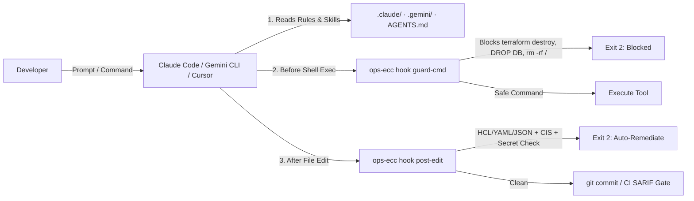

<div align="center">

# `ops-ecc`

**The Full-Stack, Cloud IaC & DevSecOps Agent Harness**

*Sub-20ms static security enforcement, deterministic infrastructure scaffolding, and native `<5ms` guardrails for Claude Code, Gemini CLI, Cursor, and Universal `AGENTS.md`.*

[](https://crates.io/crates/ops-ecc)
[](https://github.com/bilal-talha-dev/ops-ecc/releases/tag/v0.1.0)
[](LICENSE)
[](https://www.rust-lang.org/)

[Instant Setup](#instant-setup) · [How It Works](#how-it-works) · [What's Included](#whats-included) · [Cross-Tool Matrix](#cross-tool-compatibility) · [Documentation](#documentation)

</div>

---

Your AI coding agent can generate Terraform, Dockerfiles, and backend APIs—but without deterministic guardrails, it will ship unpinned `:latest` images, `0.0.0.0/0` security groups, hardcoded credentials, and unguarded `terraform destroy` commands.

**`ops-ecc`** turns any coding agent into a coordinated, zero-trust Full-Stack + DevSecOps engineering system:

```text
plan -> infra-sync -> implement -> post-edit validate -> audit (SARIF) -> guard-cmd -> ship
```

Instead of repeating security checklists in every prompt, you install `ops-ecc` once as a single statically linked Rust binary and make it part of how your agent—and your CI/CD pipeline—operates.

---

## Instant Setup

Pick one installation path. All rules, agents, skills, slash commands, and templates are embedded directly inside the `ops-ecc` binary—no external runtime, Node.js, or Python dependencies required.

### 1. Install the Binary

**Option A — Cargo (`crates.io`):**
```bash
cargo install ops-ecc
```

**Option B — Prebuilt Release Binary (No Rust Required):**  
Download the executable for **Windows (`.exe`)**, **macOS (Apple Silicon / Intel)**, or **Linux (`x86_64` / `ARM64`)** from **[GitHub Releases (`v0.1.0`)](https://github.com/bilal-talha-dev/ops-ecc/releases/tag/v0.1.0)** and place it on your `PATH`. See [docs/installation.md](docs/installation.md) for exact OS commands and `.sha256` verification.

**Option C — AI-Guided Setup (Claude Code / Gemini CLI):**  
Paste this prompt into your agent session:
> *"Install `https://github.com/bilal-talha-dev/ops-ecc` globally (`cargo install ops-ecc && ops-ecc init --scope global --yes --strict`) and enforce its Full-Stack, Cloud/IaC, and DevSecOps rules, agents, skills, and hooks across all tasks."*

### 2. Initialize Your Harness

```bash
# Global install: applies to ~/.claude and ~/.gemini across every project
ops-ecc init --scope global --yes --strict

# Project install: auto-detects stack and configures .claude/, .gemini/, .cursorrules, AGENTS.md
ops-ecc init --yes --preset all --cloud both --strict

# Verify machine readiness & hook bindings
ops-ecc doctor
```

---

## How It Works

When `ops-ecc` is connected to **Claude Code** or **Gemini CLI**, three layers operate in tandem:

1. **Always-On Engineering Governance (`.claude/rules/`, `.gemini/rules/`, `AGENTS.md`):**  
   Loaded automatically into every session—enforcing contract-first SDD/TDD, the **Mandatory Infra-Sync Rule** (synchronizing app env vars, queues, buckets, and ports with Terraform/CloudFormation), least-privilege IAM, and OIDC CI/CD.
2. **Sub-5ms Native Rust Hooks (`ops-ecc hook`):**  
   Wired into `.claude/settings.json` (`PreToolUse`, `PostToolUse`, `PreCommit`) and `.gemini/settings.json` (`BeforeTool`, `AfterTool`, `PreCommit`). Every file edit is parsed and audited in real time; every destructive shell command is intercepted before execution.
3. **Standalone Parallel Engine (`audit`, `scaffold`, `doctor`):**  
   Runs independently of any AI agent—scanning entire repositories in `<20ms` via `rayon` + `ignore` + `hcl-rs` and exporting **SARIF 2.1.0** reports for GitHub Code Scanning.



---

## What's Included

| Component | Count | Highlights | Reference |
| :--- | :---: | :--- | :--- |
| **Core Rules** | 4 | Full-Stack SDD/TDD + Infra-Sync, Terraform & CloudFormation, Zero-Trust CIS/IAM, OIDC CI/CD & Edge | [AI Harness Guide](docs/ai-harness-integration.md) |
| **Specialized Agents** | 8 | `fullstack-architect`, `terraform-engineer`, `cfn-specialist`, `cloud-infra-architect`, `container-hardener`, `devsecops-auditor`, `cicd-release-engineer`, `incident-sre-debugger` | [AI Harness Guide](docs/ai-harness-integration.md) |
| **Slash Commands** | 6 | `/plan-stack`, `/infra-gen`, `/sec-audit`, `/harden-docker`, `/setup-oidc-cicd`, `/triage-incident` | [AI Harness Guide](docs/ai-harness-integration.md) |
| **Deep Skills** | 6 | `terraform-aws-azure`, `cloudformation-production`, `devsecops-iam-cis`, `docker-k8s-hardening`, `cicd-oidc-pipelines`, `nginx-cloudflare-edge` | [AI Harness Guide](docs/ai-harness-integration.md) |
| **Static Security Rules** | 29+ | Secrets (`AKIA`, Azure, PEM, JWT, DB URIs, AI keys), Dockerfile CIS, K8s/Compose, Terraform HCL, CloudFormation, GitHub Actions, Lockfiles | [CLI & Scanner Reference](docs/cli-and-scanner.md) |
| **Hardened Scaffolds** | 6 | `terraform-aws`, `terraform-azure`, `cfn-aws`, `docker-prod`, `cicd-oidc`, `edge-proxy` | [CLI & Scanner Reference](docs/cli-and-scanner.md) |

---

## Cross-Tool Compatibility

| Target Surface | Generated Artifacts | Hook Enforcement |
| :--- | :--- | :--- |
| **Claude Code** | `.claude/{rules,agents,commands,skills,settings.json}` | `PreToolUse` (`guard-cmd`), `PostToolUse` (`post-edit`), `PreCommit` |
| **Gemini CLI** | `.gemini/{rules,agents,commands,skills,settings.json}` + `GEMINI.md` | `BeforeTool` (`guard-cmd`), `AfterTool` (`post-edit`), `PreCommit` |
| **Cursor** | `.cursorrules` | Rule & Infra-Sync context |
| **Universal Agents** | `AGENTS.md` | Portable specification for Codex, OpenCode, Aider, Copilot |
| **CI/CD & Local CLI** | `ops-ecc audit --strict --format sarif` | Exit code `1` gate + GitHub Code Scanning SARIF 2.1.0 |

---

## Core CLI Usage

```bash
# Scan current repository (rich terminal table)
ops-ecc audit .

# Enforce strict gate & emit SARIF 2.1.0 for GitHub Code Scanning
ops-ecc audit . --strict --format sarif --output ops-ecc.sarif

# Generate production-hardened templates
ops-ecc scaffold terraform-aws --out ./infra
ops-ecc scaffold docker-prod --out ./docker
ops-ecc scaffold cicd-oidc --out .

# Upgrade embedded rules/agents/skills while preserving USER_CUSTOM blocks
ops-ecc update
```

---

## Documentation

- **[Installation & Release Binaries](docs/installation.md)** — `cargo install`, GitHub Releases binaries (Windows `.exe`, macOS, Linux), `.sha256` verification, `PATH`, and shell completions.
- **[AI Harness Integration](docs/ai-harness-integration.md)** — Global vs. project setup, live hook lifecycle diagrams, and full agent/skill/command reference.
- **[CLI & DevSecOps Scanner Reference](docs/cli-and-scanner.md)** — Complete subcommand flags, 29+ security rule IDs (`SEC-*`, `DOCKER-*`, `K8S-*`, `IAC-*`, `CICD-*`, `DEP-*`), and SARIF integration.
- **[Real-World Repository Testing](docs/real-world-testing.md)** — Verified benchmarks against `bridgecrewio/terragoat`, `bridgecrewio/cfngoat`, and `madhuakula/kubernetes-goat`.
