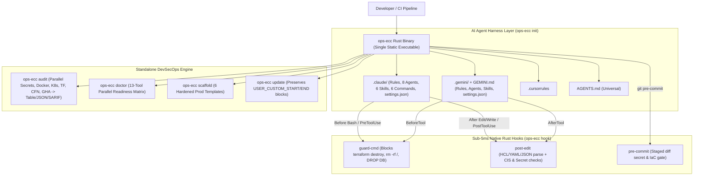

# `ops-ecc` — Full-Stack + Heavy DevOps & DevSecOps Agent Harness

[](https://crates.io/crates/ops-ecc)
[](https://github.com/bilal-talha-dev/ops-ecc/releases/tag/v0.1.0)
[](LICENSE)
[](https://www.rust-lang.org/)

**`ops-ecc`** is a single-binary, zero-runtime-dependency **Rust CLI** and **AI Agent Harness** built for **Full-Stack**, **Cloud/IaC (AWS & Azure)**, **Container/Kubernetes**, and **DevSecOps** engineering.

---

## In Simple Terms: What Is `ops-ecc` & What Can You Use It For?

Whether you work solo, with a team, or with AI coding assistants, `ops-ecc` acts as both your **automated DevSecOps security guard** and your **AI engineering rulebook**:

- **Scan any repo for security bugs in under 20ms (`ops-ecc audit`)**: Finds leaked AWS/Azure/API keys, hardcoded database passwords, `0.0.0.0/0` open SSH/DB ports in Terraform & CloudFormation, root/unpinned Dockerfiles, privileged Kubernetes pods, and insecure GitHub Actions — without needing Docker, Python, or an AI running.
- **Stop dangerous commands before they run (`ops-ecc hook guard-cmd`)**: Automatically blocks `terraform destroy`, `aws s3 rb --force`, `DROP DATABASE`, `rm -rf /`, and `kubectl delete namespace prod` before they can wipe out production.
- **Generate production-ready infrastructure in 1 second (`ops-ecc scaffold`)**: Outputs hardened AWS/Azure Terraform, CloudFormation, non-root multi-stage Dockerfiles, OIDC GitHub Actions pipelines, and Nginx + Cloudflare Tunnel configs that already pass strict security audits.
- **Check your machine & CI readiness (`ops-ecc doctor`)**: Audits 13 DevOps/DevSecOps tools (`git`, `docker`, `terraform`, `tflint`, `checkov`, `cfn-lint`, `hadolint`, `trivy`, `gitleaks`, `aws`, `az`, `node`, `python3`) in parallel and tells you what is ready or missing.
- **Keep app code and infrastructure in sync (`Infra-Sync Rule`)**: Enforces that whenever you add an environment variable, queue, bucket, or database in your Next.js/Node/FastAPI/Rust code, the matching Terraform/CloudFormation/Docker config is updated at the same time.

---

## What Happens When You Connect `ops-ecc` to Claude Code (or Gemini CLI)?

Once you run `ops-ecc init` (globally or inside a project) and open **`claude`** (or **`gemini`** / **Cursor**), your AI assistant is upgraded with a full DevOps & DevSecOps safety net:

1. **It follows your production rulebook automatically:** Claude loads `.claude/rules/`, 8 specialized DevOps/Security agents, and 6 deep skills — so it writes least-privilege IAM, encrypted RDS/S3, and non-root Dockerfiles by default instead of insecure shortcuts.
2. **Every file edit is checked live in `<5ms`:** The moment Claude edits a `.tf`, `.yaml`, `Dockerfile`, or `.json` file, Claude Code automatically triggers `ops-ecc hook post-edit`. If there is a syntax error, hardcoded secret, or `0.0.0.0/0` port exposure, `ops-ecc` blocks it (`exit code 2`) and tells Claude the exact line and fix — so **Claude fixes its own mistake before finishing**.
3. **Destructive shell commands are blocked:** If Claude ever tries to run `terraform destroy` or `DROP TABLE`, `ops-ecc hook guard-cmd` intercepts and blocks it before execution.
4. **You get 6 ready-to-use DevOps slash commands:** Type `/plan-stack`, `/infra-gen`, `/sec-audit`, `/harden-docker`, `/setup-oidc-cicd`, or `/triage-incident` directly inside Claude Code.

---

## Architecture Overview



---

## Quick Start (Choose Your Installation Method)

### Option A: Install via Cargo (`crates.io`) — Recommended if Rust is Installed
```bash
cargo install ops-ecc
```
*(Don't have Rust yet? See the 1-line Rustup installer in [docs/installation.md](docs/installation.md).)*

### Option B: Download Prebuilt Binary (No Rust Required)
Download the ready-to-run binary for **Windows (`.exe`)**, **macOS (Apple Silicon & Intel)**, or **Linux (`x86_64` & `ARM64`)** from the **[GitHub Releases Page (`v0.1.0`)](https://github.com/bilal-talha-dev/ops-ecc/releases/tag/v0.1.0)** — full OS-by-OS setup instructions are in [docs/installation.md](docs/installation.md).

### Option C: Install Globally via Claude Code / Gemini CLI Prompt
Paste this prompt directly into **Claude Code** or **Gemini CLI**:
> *"Install `https://github.com/bilal-talha-dev/ops-ecc` globally (`cargo install ops-ecc && ops-ecc init --scope global --yes --strict`) and follow its Full-Stack, Cloud/IaC, and DevSecOps rules, agents, skills, and hooks for all coding tasks."*

---

## 60-Second Workflow

```bash
# 1. Verify local DevOps tools & hook status
ops-ecc doctor

# 2. Initialize AI harness globally (applies to ~/.claude and ~/.gemini across ALL projects)
ops-ecc init --scope global --yes --strict

#    OR initialize inside a single repository (creates .claude/, .gemini/, .cursorrules, AGENTS.md)
ops-ecc init --yes --preset all --cloud both --strict

# 3. Run a high-speed parallel DevSecOps audit (Table or SARIF 2.1.0)
ops-ecc audit .
ops-ecc audit . --strict --format sarif --output ops-ecc.sarif

# 4. Generate production-hardened infrastructure templates
ops-ecc scaffold terraform-aws --out ./infra
ops-ecc scaffold docker-prod --out ./docker
ops-ecc scaffold cicd-oidc --out .
```

---

## What's Inside the Binary

| Capability | Details | Reference |
| :--- | :--- | :--- |
| **4 Core Rules** | Full-Stack SDD/TDD + **Mandatory Infra-Sync**, Terraform/CloudFormation, Zero-Trust CIS/IAM, OIDC CI/CD & Edge | [AI Harness Guide](docs/ai-harness-integration.md) |
| **8 Specialized Agents** | `fullstack-architect`, `terraform-engineer`, `cfn-specialist`, `cloud-infra-architect`, `container-hardener`, `devsecops-auditor`, `cicd-release-engineer`, `incident-sre-debugger` | [AI Harness Guide](docs/ai-harness-integration.md) |
| **6 Slash Commands** | `/plan-stack`, `/infra-gen`, `/sec-audit`, `/harden-docker`, `/setup-oidc-cicd`, `/triage-incident` | [AI Harness Guide](docs/ai-harness-integration.md) |
| **6 Deep Skills** | `terraform-aws-azure`, `cloudformation-production`, `devsecops-iam-cis`, `docker-k8s-hardening`, `cicd-oidc-pipelines`, `nginx-cloudflare-edge` | [AI Harness Guide](docs/ai-harness-integration.md) |
| **29+ Built-in Security Rules** | Secrets (`AKIA`, Azure, PEM, JWT, DB URIs, AI tokens), Dockerfile CIS, K8s/Compose, Terraform HCL, CloudFormation, GitHub Actions OIDC/SHA, Lockfiles | [CLI & Scanner Reference](docs/cli-and-scanner.md) |
| **6 Hardened Scaffolds** | `terraform-aws`, `terraform-azure`, `cfn-aws`, `docker-prod`, `cicd-oidc`, `edge-proxy` | [CLI & Scanner Reference](docs/cli-and-scanner.md) |

---

## Documentation Guides (`docs/`)

- **[Installation & Release Binaries Guide](docs/installation.md)** — Installing via `cargo install ops-ecc`, downloading Windows `.exe` / macOS / Linux binaries from GitHub Releases, `.sha256` verification, `PATH` setup, and shell completions.
- **[AI Harness Integration Guide (Claude Code, Gemini CLI, Cursor)](docs/ai-harness-integration.md)** — Global vs. project setup, how native Rust hooks intercept dangerous commands & validate edits in `<5ms`, and full agent/skill/command catalog.
- **[CLI Commands & DevSecOps Scanner Reference](docs/cli-and-scanner.md)** — Every subcommand, flag, security rule ID (`SEC-*`, `DOCKER-*`, `K8S-*`, `IAC-*`, `CICD-*`, `DEP-*`), SARIF CI/CD integration, and `ops-ecc update` custom-block preservation.
- **[Real-World Public Repo Testing Guide](docs/real-world-testing.md)** — Step-by-step verification against `bridgecrewio/terragoat`, `bridgecrewio/cfngoat`, and `madhuakula/kubernetes-goat`.
