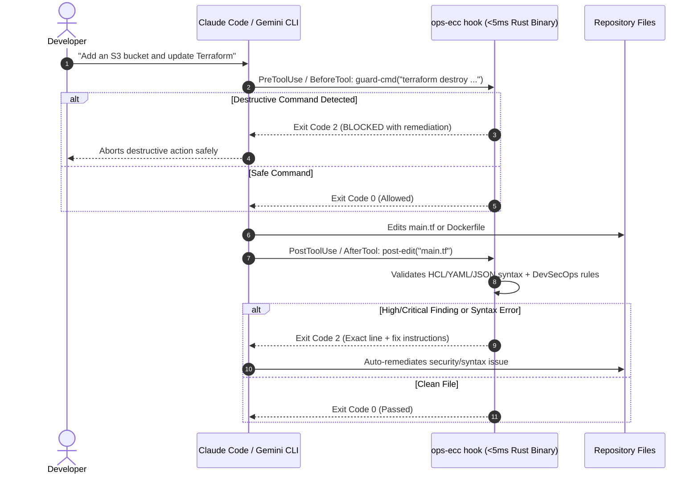

# AI Agent Harness Integration Guide (Claude Code, Gemini CLI, Cursor & AGENTS.md)

Once `ops-ecc` is installed on your machine, you connect it to your AI coding assistants using `ops-ecc init`.

---

## Global vs. Per-Project Installation

### 1. Global Installation (Recommended — Applies to Every Project)
Run once to install rules, agents, skills, slash commands, and hooks into `~/.claude/` and `~/.gemini/`:
```bash
ops-ecc init --scope global --yes --strict
```
Every time you launch `claude` or `gemini` in **any** folder, your Full-Stack + DevOps/DevSecOps rules and hooks are automatically active.

### 2. Per-Project Installation
Run inside a specific repository:
```bash
cd /path/to/your-repo
ops-ecc init --yes --preset all --cloud both --strict
```
`ops-ecc` auto-detects your stack (`package.json`, `pyproject.toml`, `Cargo.toml`, `Dockerfile`, `*.tf`, `template.yaml`, `.github/workflows`) and creates:
- `.claude/` (`rules/`, `agents/`, `commands/`, `skills/`, `settings.json`)
- `.gemini/` (`rules/`, `agents/`, `commands/`, `skills/`, `settings.json`) + `GEMINI.md`
- `.cursorrules`
- `AGENTS.md`

> **Safe Overwrites:** If `.claude/`, `.gemini/`, `.cursorrules`, or `AGENTS.md` already exist, `ops-ecc init` automatically saves a timestamped snapshot to `.ops-ecc-backup-<YYYYMMDD-HHMMSS>/` first.

---

## How Native Rust Hooks Work Live with Claude Code & Gemini CLI



### Hook Bindings Written Automatically
- **Claude Code (`.claude/settings.json`)**:
  - `PreToolUse` (`Bash`) → `ops-ecc hook guard-cmd "$CLAUDE_TOOL_INPUT_COMMAND"`
  - `PostToolUse` (`Edit|Write|MultiEdit`) → `ops-ecc hook post-edit "$CLAUDE_FILE_PATH"`
  - `PreCommit` → `ops-ecc hook pre-commit --strict`
- **Gemini CLI (`.gemini/settings.json`)**:
  - `BeforeTool` (`run_shell_command`) → `ops-ecc hook guard-cmd "$GEMINI_COMMAND"`
  - `AfterTool` (`write_file|replace`) → `ops-ecc hook post-edit "$GEMINI_FILE_PATH"`
  - `PreCommit` → `ops-ecc hook pre-commit --strict`

---

## Embedded Harness Catalog

### 4 Core Rules (`rules/`)
1. **`01-fullstack-sdd-tdd.md`** — Contract-first SDD/TDD, Prisma/Alembic migration hygiene, Redis TTL conventions, and the **Mandatory Infra-Sync Rule** (every new env var, bucket, queue, or port in app code must be synchronized with `.tf`/CloudFormation/`docker-compose.yml` in the same change).
2. **`02-iac-terraform-cfn.md`** — Remote state locking (`s3` + DynamoDB / `azurerm`), pinned provider constraints, `prevent_destroy = true`, and CloudFormation `DeletionPolicy: Retain` + `NoEcho`.
3. **`03-devsecops-zero-trust.md`** — Zero hardcoded secrets, zero `0.0.0.0/0` on SSH/RDP/DB ports, KMS encryption at rest, IAM least-privilege, non-root multi-stage containers.
4. **`04-cicd-and-edge.md`** — Passwordless AWS/Azure OIDC federation, 40-char commit SHA pinning for GitHub Actions, script-injection prevention, SARIF gates, hardened Nginx & Cloudflare Zero Trust Tunnels.

### 8 Specialized Agents (`agents/`)
- `fullstack-architect` — Next.js/React, Node/FastAPI/Django/Rust, PostgreSQL, Redis, Infra-Sync.
- `terraform-engineer` — Modular AWS & Azure Terraform, state locking, KMS encryption.
- `cfn-specialist` — Nested CloudFormation & SAM stacks, change sets, `DeletionPolicy: Retain`.
- `cloud-infra-architect` — Multi-AZ VPC/VNet segmentation, private endpoints, SQS/Service Bus DLQs.
- `container-hardener` — CIS Docker/K8s Benchmarks, non-root distroless builds, `cap_drop: [ALL]`.
- `devsecops-auditor` — OWASP Top 10, secret scanning, IAM privilege escalation, SARIF triage.
- `cicd-release-engineer` — OIDC pipelines, SHA-pinned actions, Trivy + `ops-ecc` gates.
- `incident-sre-debugger` — Blast-radius containment, 5-Whys RCA, container OOM/crashloop debugging.

### 6 Slash Commands (`commands/`)
- `/plan-stack` — 4-layer Full-Stack + Infra-Sync architecture blueprint.
- `/infra-gen` — Generate synchronized Terraform / CloudFormation modules.
- `/sec-audit` — Run `ops-ecc audit` and remediate all Critical/High findings.
- `/harden-docker` — Harden Dockerfiles, Compose, and Kubernetes manifests.
- `/setup-oidc-cicd` — Generate OIDC-authenticated, SHA-pinned CI/CD workflows with SARIF upload.
- `/triage-incident` — Execute structured SRE incident triage and safe remediation.

### 6 Deep Skills (`skills/`)
- `terraform-aws-azure`
- `cloudformation-production`
- `devsecops-iam-cis`
- `docker-k8s-hardening`
- `cicd-oidc-pipelines`
- `nginx-cloudflare-edge`
